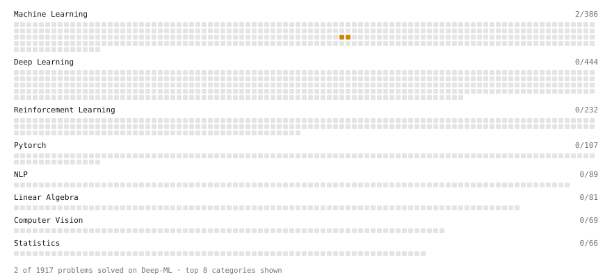

# Deep-ML

My machine learning practice from [Deep-ML](https://www.deep-ml.com). Every solution here was written by hand.

**2** solved · 2 problems · 0 labs · 0 math

[**Browse the interactive portfolio**](https://JIBLIR.github.io/deep-ml/) to replay this filling in over time.

## Problems

| | Difficulty | Solved | |
| --- | --- | --- | --- |
| [Logit Lens Projection](https://www.deep-ml.com/problems/860) | medium | 2026-11-05 | [solution](problems/0860-logit-lens-projection) |
| [Tuned Lens - Learned Affine Probe per Layer](https://www.deep-ml.com/problems/861) | medium | 2026-11-05 | [solution](problems/0861-tuned-lens-learned-affine-probe-per-layer) |

---

_This file is regenerated by Deep-ML on every push._
